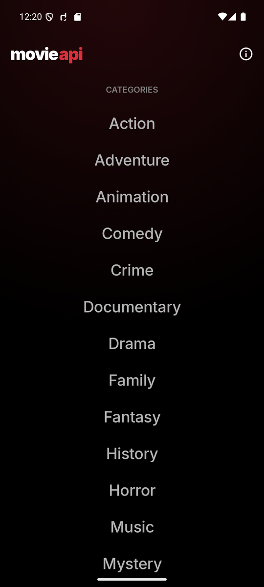
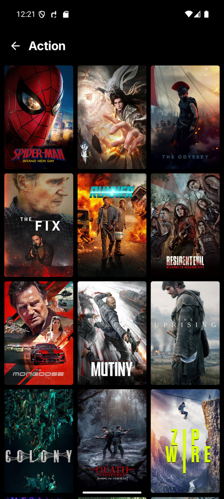
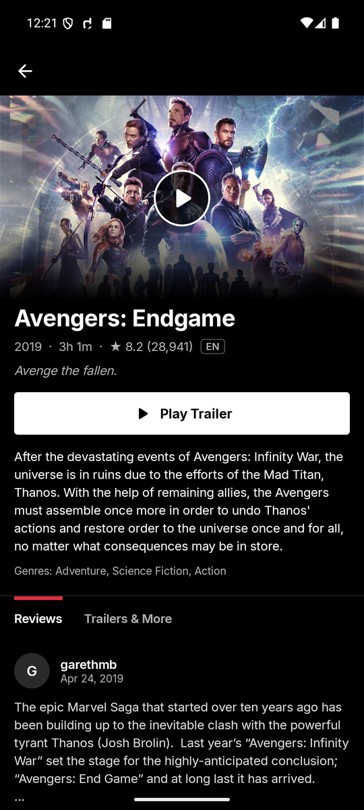
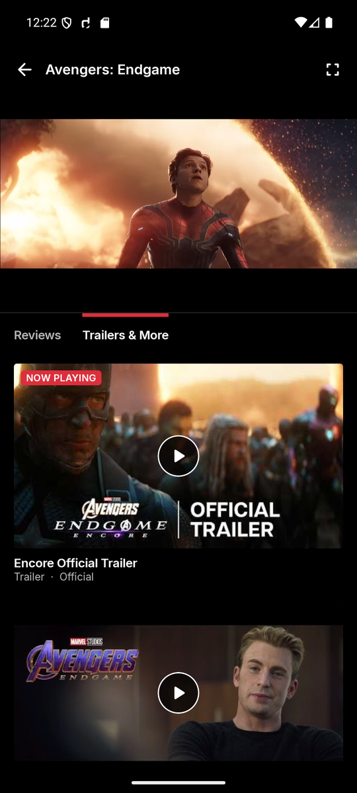
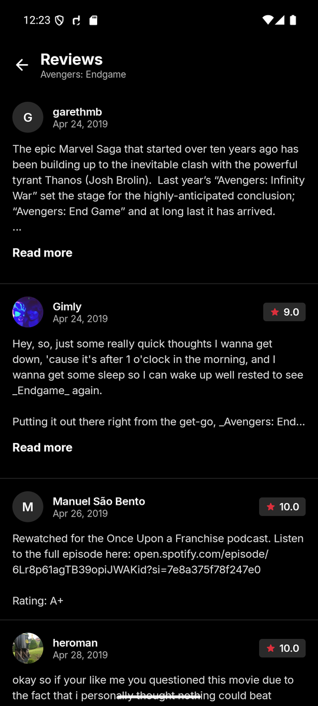
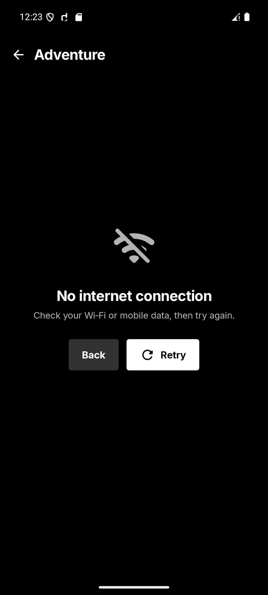
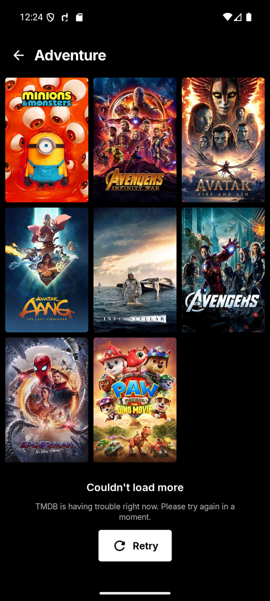
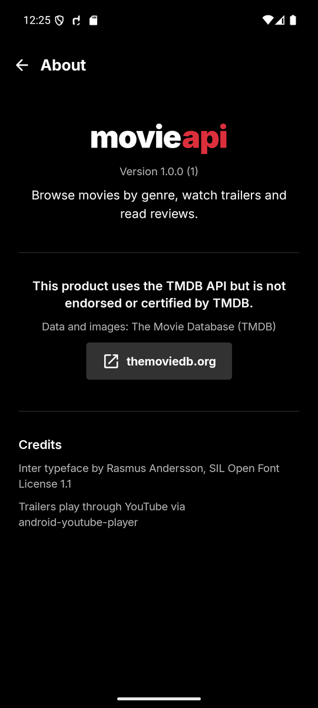
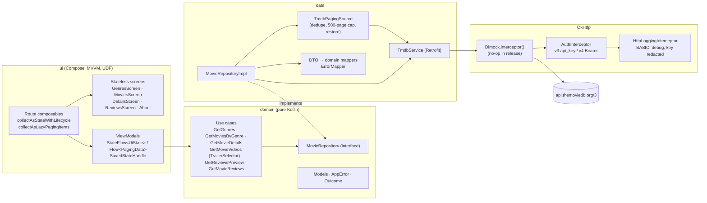

# Movie API

A streaming-style Android movie browser built on [The Movie Database (TMDB)](https://www.themoviedb.org/) API: browse genres, scroll endless poster grids, open a movie, watch its trailer inline and read every review. It's native Kotlin + Jetpack Compose with Clean Architecture, Hilt, Paging 3 and an inline YouTube player, and every positive and negative network case is reproducible with [dimock](https://github.com/yudistirosaputro/dimock) rule files.

> This product uses the TMDB API but is not endorsed or certified by TMDB.

<table>
  <tr>
    <td></td>
    <td></td>
    <td></td>
    <td></td>
  </tr>
  <tr>
    <td><sub>Genres (start screen)</sub></td>
    <td><sub>Movies by genre, 3-column grid</sub></td>
    <td><sub>Details</sub></td>
    <td><sub>Inline trailer + Trailers &amp; More</sub></td>
  </tr>
  <tr>
    <td></td>
    <td></td>
    <td></td>
    <td></td>
  </tr>
  <tr>
    <td><sub>All reviews (paged)</sub></td>
    <td><sub>Offline error + Retry</sub></td>
    <td><sub>Page 2 failed: footer Retry, page 1 kept</sub></td>
    <td><sub>About + TMDB attribution</sub></td>
  </tr>
</table>

## Evidence videos

Recorded on the `claude_API36` emulator (Android 16), with taps drawn as touch markers. Still stretches are capped at 1.5 s.

| Video | Shows |
|---|---|
| [`01-happy-path.mp4`](docs/evidence/01-happy-path.mp4) (2:36) | Cold launch → genres → Action → 6 discover pages → *Avengers: Endgame* → inline trailer → Trailers & More (another video plays in the media area) → Read more → See all reviews (59) → reviews pages 1-3 |
| [`02-network-failures.mp4`](docs/evidence/02-network-failures.mp4) (1:14) | N1 Wi-Fi + data off → "No internet connection" → network back → Retry · N2 skeleton during a 4 s response, then a one-shot timeout → Retry · N5 429 and 503 → Retry after the rule is cleared |
| [`03-data-edge-cases.mp4`](docs/evidence/03-data-edge-cases.mp4) (1:13) | N3 401 · N7 empty genres / empty genre · N4 404 → Back · N6 malformed JSON → Retry · N7 + N8 no reviews / no trailer · N9 null posters, backdrop, overview, runtime, date, avatar |
| [`04-paging-append-failure.mp4`](docs/evidence/04-paging-append-failure.mp4) (0:38) | N10: page 2 answers 500 once → footer "Couldn't load more" + Retry, page 1 stays → Retry → pages 2-4 |
| [`05-rotation-process-death.mp4`](docs/evidence/05-rotation-process-death.mp4) (2:14) | N12: deep scroll position kept across rotation; details tab, scroll and playing trailer kept across rotation; HOME → `am kill` → relaunch restores details, tab and trailer position, and the grid's deep scroll position |

## Features (user stories)

| Story | What you get |
|---|---|
| **US1 Genres** | A full-screen "Categories" list of TMDB's official movie genres: large centered names that turn white and bold while pressed, an original wordmark, and an info button that opens About. Skeleton / content / empty / error + Retry. |
| **US2 Discover** | Popular movies of the genre in a 3-column poster grid (2:3, 4 dp corners, title as content description; the title is shown on the card when there's no poster). The top bar fades to black as you scroll. |
| **US3 Details** | Pinned 16:9 media area (backdrop fading to black; poster → backdrop shared-element transition), title, `2019 · 3h 1m · ★ 8.2 (28,941)` with an original-language badge, tagline, Play Trailer, overview (or "No overview available"), genres. Every field degrades on its own; loading, error and not-found states. |
| **US4 Reviews** | Reviews tab with the first 3 reviews and "See all reviews (N)". Each review shows an avatar (or initial), author, rating chip, date, and content collapsed to 6 lines with Read more. "No reviews yet" when empty. Paged reviews screen. |
| **US5 Trailer** | Videos load separately from details. The trailer is picked as: official YouTube trailer, newest first → teaser → hidden with "Trailer not available". Plays inline with a full-screen toggle; falls back to "Open in YouTube" on player errors; every YouTube video in Trailers & More plays in the media area. |
| **US6 Endless scrolling** | Paging 3 with prefetch, unique keys (cross-page duplicates dropped), stops at `total_pages` or page 500, red footer loader, footer Retry on append failure, full-screen error only for the first page. |
| **US7 Positive & negative cases** | See the [case matrix](#case-matrix). |

## Architecture



Packages: `data` (DTOs, Retrofit service, auth, mappers, error mapping, PagingSource, repository), `domain` (models, repository interface, use cases, trailer selection), `ui` (theme, components, navigation, one package per screen) and `di` (Hilt modules).

### Tech stack

| Area | Library (version) |
|---|---|
| Build | AGP 9.4.1 (built-in Kotlin), Gradle 9.8.1, Kotlin 2.4.21, KSP 2.3.12, version catalog |
| UI | Jetpack Compose BOM 2026.09.00, Material 3, Navigation Compose 2.10.2 (type-safe), `SharedTransitionLayout`, Coil 3.6.3, Inter |
| Architecture | Hilt 2.60.1, AndroidX Lifecycle 2.11.0 (`collectAsStateWithLifecycle`, `SavedStateHandle`), Coroutines/Flow 1.11.0 |
| Data | Retrofit 3.0.0 + kotlinx.serialization 1.11.0, OkHttp 5.5.0, Paging 3.5.2 |
| Video | android-youtube-player 13.0.0 (in `AndroidView`, lifecycle-aware) |
| Debug | dimock 0.1.0-alpha02 (`dimock-ui` debug / `dimock-okhttp-no-op` release) |
| Tests | JUnit 4, kotlinx-coroutines-test, Turbine 1.2.1, MockWebServer 5.5.0, paging-testing (`TestPager`, `asSnapshot`), Robolectric 4.17, Compose UI test |

## Setup

1. Get a TMDB credential at <https://www.themoviedb.org/settings/api>: either the **v3 API key** or the **v4 Read Access Token**. The app detects which is which.
2. Add it to your **user-level** Gradle properties, never the project's:
   - macOS / Linux: `~/.gradle/gradle.properties`
   - Windows: `%USERPROFILE%\.gradle\gradle.properties`

   ```properties
   MOVIE_API=your_key_or_token
   ```

   Surrounding quotes are tolerated.
3. Check it without printing it:

   ```bash
   ./gradlew checkMovieApiKey   # prints "MOVIE_API: present" or "MOVIE_API: missing"
   ```

   Without the key the app still builds (with a Gradle warning) and shows an "API key missing" screen.

Requirements: JDK 17+ (Gradle downloads a 17 toolchain if needed) and the Android SDK with platform 37.

## Build, run, test

```bash
./gradlew assembleDebug                 # debug APK (dimock enabled)
./gradlew assembleRelease               # R8-minified release APK (dimock no-op), unsigned
./gradlew installDebug                  # or: android run --apks=app/build/outputs/apk/debug/app-debug.apk

./gradlew testDebugUnitTest             # 91 JVM unit tests
./gradlew connectedDebugAndroidTest     # 33 Compose UI tests (emulator/device; set ANDROID_SERIAL if several are connected)
./gradlew lint
```

### Reproducing the failure cases with dimock

With the debug build running:

```bash
npx dimock connect --app com.yudistirosaputro.movieapi
npx dimock mock set docs/dimock-rules/n10-append-failure.yaml   # one scenario at a time
npx dimock mock list
npx dimock mock clear                                            # always clear afterwards
```

`docs/dimock-rules/` has one file per case (N2–N10). The bodies reuse the real fixtures in `app/src/test/resources/fixtures`. With dimock CLI 0.1.0-alpha02 use `mock set <file>`; `mock add <file>` has a CLI bug (see [DECISIONS](docs/DECISIONS.md)).

## Case matrix

| # | Scenario | Result | How it was verified |
|---|---|---|---|
| P1 | All endpoints succeed | Content on every screen | Live TMDB in video 01 · repository tests with captured fixtures · UI content tests |
| P2 | Multi-page scrolling | Pages append to the end | Video 01 (discover pages 1-6, reviews 1-3) · `TmdbPagingSourceTest` (TestPager: refresh/append/end/500 cap) · `MovieRepositoryImplTest` (`asSnapshot` over captured pages 1-2) |
| P3 | Movie with trailer + reviews | Trailer plays inline; reviews paginate | Video 01 (*Avengers: Endgame*) · `TrailerSelectorTest` · `DetailsViewModelTest` |
| N1 | No internet | "No internet connection" + Retry; recovers once back online | Video 02 (`svc wifi/data disable` → enable → Retry) · `ErrorMapperTest` · `GenresViewModelTest` (retry) |
| N2 | Slow network / timeout | Skeleton while slow; timeout → error + Retry | Video 02 (`n2-slow-discover.yaml`, `n2-timeout-discover.yaml`) · `ErrorMapperTest` |
| N3 | 401 invalid key | "Invalid API key", no crash | Video 03 (`n3-unauthorized-genres.yaml`) · `ErrorMapperTest`, `MovieRepositoryImplTest` · `GenresScreenTest` |
| N4 | 404 movie | "Movie not found" + Back | Video 03 (`n4-not-found-details.yaml`) · `MovieRepositoryImplTest` · `DetailsScreenTest` |
| N5 | 429 / 5xx | Friendly server error + Retry | Video 02 (`n5-rate-limited-discover.yaml`, `n5-server-unavailable-details.yaml`) · `ErrorMapperTest` · `MoviesScreenTest` |
| N6 | Malformed JSON | Parsing error state, no crash | Video 03 (`n6-malformed-details.yaml`) · `MovieRepositoryImplTest` (malformed + empty body) · `DetailsScreenTest` |
| N7 | Empty genres / discover / reviews | Dedicated empty states | Video 03 (`n7-*.yaml`) · `GenresViewModelTest`, `GenresScreenTest`, `MoviesScreenTest`, `ReviewsScreenTest`, `DetailsScreenTest` |
| N8 | No trailer | Play hidden, "Trailer not available" | Video 03 (`n7-n8-empty-reviews-and-videos.yaml`) · `TrailerSelectorTest`, `DetailsViewModelTest`, `DetailsScreenTest` |
| N9 | Null fields | Fallbacks, layout intact | Video 03 (`n9-null-fields.yaml`) · `MappersTest` · `DetailsScreenTest` · `ReviewsScreenTest` |
| N10 | Page 2+ append fails | Footer error + Retry, earlier items kept | Video 04 (`n10-append-failure.yaml`) · `TmdbPagingSourceTest` · `UiMappingTest` · `MoviesScreenTest` |
| N11 | `MOVIE_API` missing | Builds; "API key missing" | `TmdbCredentialTest`, `AuthInterceptorTest`, `MovieRepositoryImplTest` (no request sent), `GenresViewModelTest`, `GenresScreenTest` · Gradle warning + `checkMovieApiKey` |
| N12 | Rotation / process death | State and scroll position kept | Video 05 (`am kill` while backgrounded) · `DetailsViewModelTest` (player state via `SavedStateHandle`) · `PagedViewModelsTest` (restore index) · `TmdbPagingSourceTest` (multi-page restore) |

## Known limitations

- No offline cache: without a network every screen shows its error state. Recovery is the Retry button; the app doesn't auto-retry when connectivity returns.
- Trailers play only if the uploader allows embedding; otherwise the app offers "Open in YouTube".
- Entering or leaving full screen rotates the activity, so the player reloads (about a second) and resumes from the saved position.
- A restored grid reloads at most 10 pages, and TMDB's popularity order can shift between sessions, so neighbours of the restored item may differ slightly.
- Dark theme and English only; review text is shown as TMDB returns it (Markdown markers included).
- The release APK is unsigned.

## More

- [docs/DECISIONS.md](docs/DECISIONS.md): every decision, deviation and fallback, with a one-line reason
- [docs/REPORT.md](docs/REPORT.md): final run report
- Data and images: [TMDB](https://www.themoviedb.org/). Inter typeface: SIL Open Font License ([docs/licenses/Inter-OFL.txt](docs/licenses/Inter-OFL.txt)).
